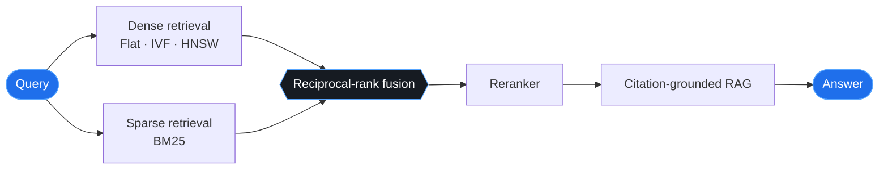
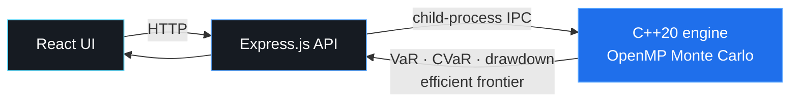

<div align="center">


<br/>

*I like understanding how things work, and then making them work better.*

<br/>

[](https://heyanmol.netlify.app/)
[](https://github.com/Annmool)
[](https://finintel.pages.dev/)
[](mailto:aydv.tech@gmail.com)


</div>


## 🧭 `whoami`

> Not particularly interested in stopping at *"it works."*
> I want to know **why** it works, **where** it breaks, **what** the bottleneck is, and whether I can build it better.

<table>
<tr>
<td width="50%" valign="top">

### ⚙️ Systems engineering
Performance, concurrency, networking, and what's happening beneath abstractions.

</td>
<td width="50%" valign="top">

### 🧠 AI & retrieval
Vector search, RAG, embeddings, and making information useful.

</td>
</tr>
<tr>
<td width="50%" valign="top">

### 📈 Quantitative computing
Simulations, portfolio optimisation, and the mathematics behind financial decisions.

</td>
<td width="50%" valign="top">

### 🌐 Open source
Reading real codebases, fixing things, and learning from systems built by others.

</td>
</tr>
</table>

**Currently interested in:** backend engineering · distributed systems · applied AI · and the engineering challenges that connect them.


## 🛠️ `things i've built`

<details open>
<summary><b>⚡ VectorCore: search, built from the inside out</b></summary>

<br/>

A hands-on exploration of vector databases and retrieval systems. The goal: understand the machinery instead of treating it as a black box.

- Implemented **Flat, IVF/K-Means, HNSW, BM25, scalar quantisation, and PQ-ADC** components.
- Combined dense and sparse retrieval with reciprocal-rank fusion, reranking, and citation-grounded RAG.
- Replaced repeated NumPy array reconstruction with capacity-doubling buffers.
- Vectorised distance calculations and reduced redundant computation.

**How a query flows through it:**



**One benchmark, one useful lesson:**

| Metric | Before | After | Change |
|---|---:|---:|---:|
| Build time · 1,000 × 32D vectors | 43.35 s | 2.06 s | **~21× faster** ⚡ |
| Query latency | 8.05 ms | 1.21 ms | **~6.7× faster** ⚡ |

```text
Build time   before  ████████████████████████████████████████  43.35 s
             after   ██                                         2.06 s
```

<sub>Results are from this specific benchmark and depend on workload and configuration.</sub>

</details>

<details>
<summary><b>📊 FinIntel: quantitative finance meets systems engineering</b></summary>

<br/>

[](https://finintel.pages.dev/)

A quantitative finance platform with a native C++ computation engine behind a web interface.

- **C++20 + OpenMP** for parallel Monte Carlo simulation.
- **Geometric Brownian Motion** for modelling asset-price paths.
- **Cholesky decomposition** for correlated random shocks.
- **VaR, CVaR, and maximum drawdown** for portfolio risk analysis.
- **Markowitz optimisation** and efficient-frontier exploration.
- React + Express.js + child-process IPC connecting the UI, API, and native engine.

**Architecture:**



A project about more than finance: numerical computing, process boundaries, performance, and the trade-offs involved in putting them together.

</details>

<details>
<summary><b>🔬 Q-RouteRL: quantum network routing research</b></summary>

<br/>

Exploring **reinforcement learning for constrained quantum network routing**, where routing decisions must account for more than just physical distance.

The research direction involves:

- Quantum-network modelling with distance, decoherence, and entanglement-swapping dynamics.
- Classical routing baselines for reproducible comparisons.
- A planned neuro-symbolic reinforcement-learning approach to constrained routing.

> **Current status:** The repository contains a simulator and classical routing baselines. A trained RL agent and variational quantum circuit are not yet implemented or evaluated.

</details>

<details>
<summary><b>🔐 Komms: peer-to-peer file sharing</b></summary>

<br/>

A desktop file-sharing project exploring networking, secure transfers, and responsive interfaces.

- TCP/UDP networking and chunked, multithreaded transfers.
- RSA-2048 encryption and SHA-256 integrity verification.
- PyQt6 thread-pool execution to keep the UI responsive.

</details>


## 🌐 `open source`

I enjoy working in established codebases where the details matter.

**Ceph ecosystem**

| Contribution | What it does |
|---|---|
| [ceph-nvmeof #1726](https://github.com/ceph/ceph-nvmeof/pull/1726) | Structured certificate-validation logging and exception handling around gRPC channel setup |
| [teuthology #2102](https://github.com/ceph/teuthology/pull/2102) | Structured `failure_reason` schema |
| [Ceph #68173](https://github.com/ceph/ceph/pull/68173) | Contribution to the Ceph core repository |
| [Ceph #67803](https://github.com/ceph/ceph/pull/67803) | Contribution to the Ceph core repository |

> The interesting part of debugging isn't just finding the failure. It's making the next failure easier to understand.


## 🧰 `my toolbox`

<div align="center">

<a href="https://skillicons.dev">
  
</a>

<br/><br/>


</div>

**Also exploring:** `HNSW` · `BM25` · `RAG` · `OpenMP` · `WebSockets` · `distributed systems` · `Monte Carlo methods` · `quantitative risk`


## 📈 `the github corner`

<div align="center">

<a href="https://github.com/Annmool">
  
</a>
<a href="https://github.com/Annmool">
  
</a>

<br/>


<br/>


</div>

<!--
OPTIONAL: animated contribution snake.
1. Add .github/workflows/snake.yml using Platane/snk (github-contribution-grid-snake)
2. Let it run once so it creates the "output" branch
3. Uncomment the block below

<div align="center">
  <picture>
    <source media="(prefers-color-scheme: dark)" srcset="https://raw.githubusercontent.com/Annmool/Annmool/output/github-snake-dark.svg" />
    
  </picture>
</div>
-->

<div align="center">

<br/>


</div>
